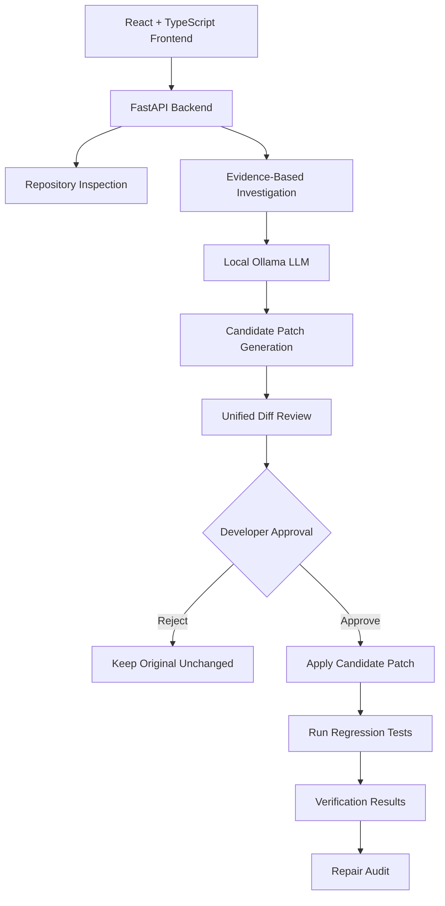
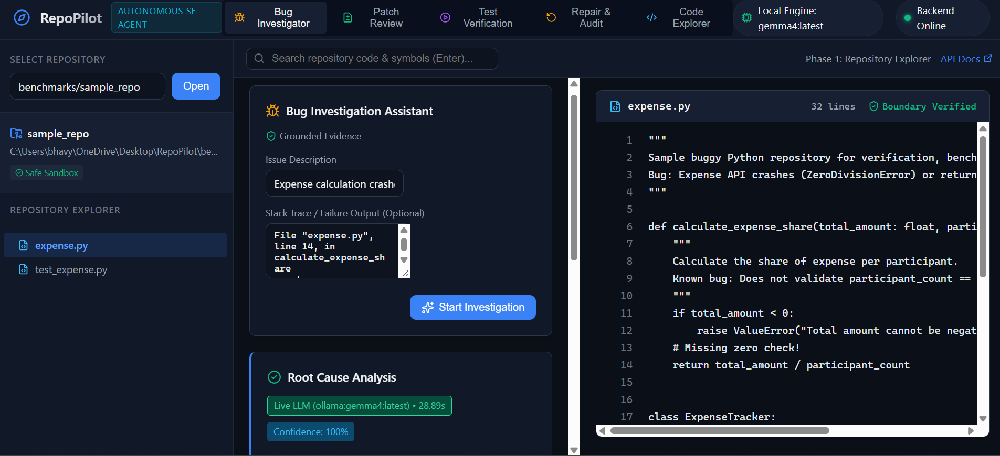
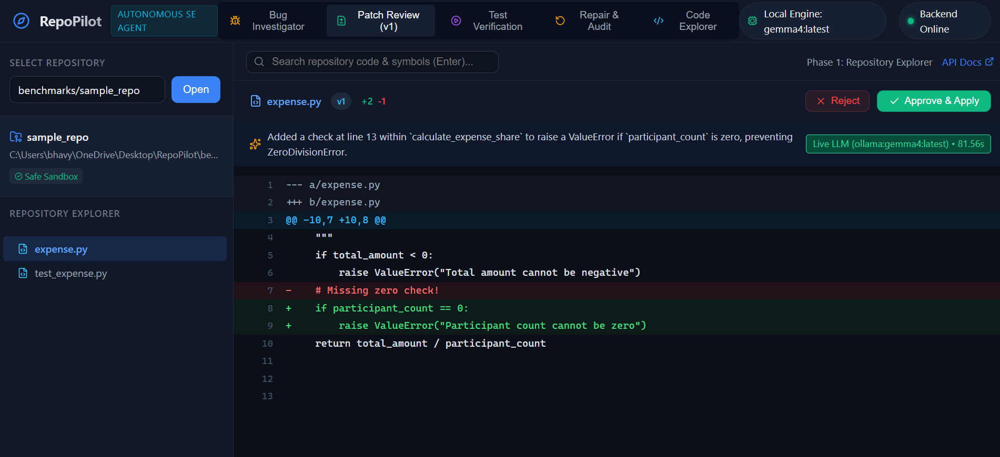
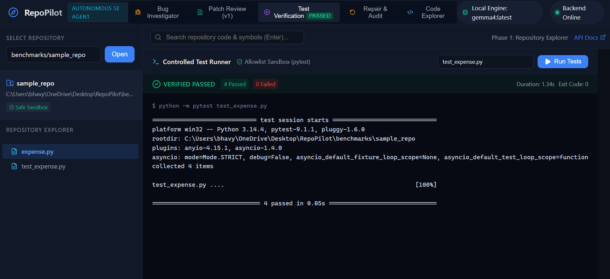
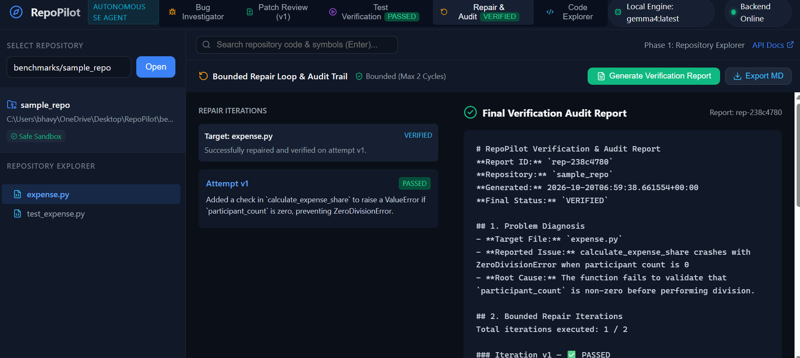

# RepoPilot — Autonomous Software Engineering Agent

<p align="center">
  <strong>Grounded Bug Investigation · Surgical Patch Review · Controlled Test Verification · Bounded Self-Repair</strong>
</p>

<p align="center">
  An AI-assisted code repair system that investigates bugs, proposes patches, and verifies changes while keeping developers in control.
</p>

<p align="center">
  
  
  
  
  
  
</p>

---

## Overview

**RepoPilot** is a free, local-first AI software engineering agent designed to help developers investigate bugs, inspect relevant code evidence, generate candidate patches, review proposed changes, and verify repairs through automated tests.

It uses a local Ollama model (`gemma4:latest`) and a FastAPI backend, paired with a React and TypeScript frontend. Its workflow combines evidence-grounded investigation, unified diff review, explicit developer approval, and bounded repair iterations.

Unlike a workflow that blindly applies generated code, RepoPilot keeps the developer involved before changes are applied to the original repository.

**Core principle: AI proposes. Developers approve. Tests verify.**

## Core Highlights

### 1. Free and Local-First

- Uses a locally hosted Ollama model for inference.
- Avoids mandatory paid cloud AI API calls in the configured local workflow.
- Keeps the application suitable for local development and experimentation.
- Does not require a cloud-hosted LLM account for local inference.

### 2. Evidence Before Hypotheses

- Inspects relevant repository files and code sections.
- Uses code evidence to support bug investigation.
- Provides structured investigation results for review.
- Helps developers trace a diagnosis back to the relevant source code.

### 3. Explicit Human Approval

- Presents candidate changes as unified diffs.
- Makes additions and deletions visible before application.
- Requires explicit developer approval before applying a proposed repair.
- Detects source-file conflicts when the relevant file changes after a patch is proposed.

### 4. Controlled Test Execution

- Supports allowlisted pytest execution.
- Applies subprocess timeouts and output-size limits.
- Reports test results for verification.
- Includes repository path validation and test-target traversal defenses.

> **Security note:** Application-level controls and subprocess timeouts are not equivalent to an operating-system sandbox. RepoPilot is intended for trusted local repositories only.

### 5. Bounded Self-Repair

- Supports a repair workflow with a maximum of two repair attempts.
- Tests repair candidates in a temporary repository copy before applying an accepted candidate to the original repository.
- Requires explicit approval before applying a repair.
- Maintains repair status and audit information for verification.

---

## Architecture

RepoPilot separates its user interface, repository investigation, patch generation, test execution, and repair orchestration into distinct components.



### Project Structure

```text
RepoPilot/
├── backend/
│   ├── app/
│   │   ├── main.py             # REST API and dependency wiring
│   │   ├── repository.py       # Repository exploration and code search
│   │   ├── security.py         # Path validation and boundary checks
│   │   ├── llm.py              # LLM provider abstractions
│   │   ├── investigator.py     # Evidence extraction and diagnosis
│   │   ├── patcher.py          # Unified diff generation and validation
│   │   ├── runner.py           # Test subprocess execution
│   │   ├── repair.py           # Bounded repair orchestration and audit
│   │   └── schemas.py          # Pydantic data models
│   └── tests/                  # Backend unit, security, and integration tests
├── frontend/
│   └── src/
│       ├── App.tsx             # Main workspace and navigation
│       ├── api.ts              # Typed REST API client
│       ├── index.css           # Application styling
│       └── components/
│           ├── CodeViewer.tsx
│           ├── FileTree.tsx
│           ├── SearchOverlay.tsx
│           ├── InvestigationPanel.tsx
│           ├── DiffViewer.tsx
│           ├── TestRunnerPanel.tsx
│           └── RepairAuditPanel.tsx
├── benchmarks/
│   └── sample_repo/            # Sample repository and regression tests
├── docs/
│   ├── API_REFERENCE.md
│   ├── ARCHITECTURE.md
│   ├── DECISIONS.md
│   ├── FINAL_ACCEPTANCE_REPORT.md
│   ├── IMPLEMENTATION_PLAN.md
│   ├── LEARNING_GUIDE.md
│   ├── PRD.md
│   ├── RECOVERY_REPORT.md
│   └── SECURITY.md
├── .gitignore
├── README.md
└── RepoPilot_PRD.md
```

Individual filenames may evolve as the project develops. The structure above describes the principal components of the application.

## Technology Stack

| Component | Technology |
|---|---|
| Frontend framework | React |
| Programming language | TypeScript |
| Frontend tooling | Vite |
| Styling | CSS |
| Backend framework | FastAPI |
| Backend language | Python |
| Data validation | Pydantic |
| Local LLM runtime | Ollama |
| Configured model | `gemma4:latest` |
| Automated testing | pytest |
| Version control | Git and GitHub |

## Quickstart

The following commands use Windows PowerShell and assume you have cloned the repository.

### Prerequisites

- Python with versions compatible with the backend dependencies.
- Node.js and npm.
- Git.
- [Ollama](https://ollama.com/).
- Sufficient local system resources to run the selected LLM.

The project was tested on Windows 11 with Python 3.14.4 and `gemma4:latest`. Other environments may require dependency or configuration adjustments.

### 1. Clone the repository

```powershell
git clone https://github.com/bhavya-431/RepoPilot.git
cd RepoPilot
```

### 2. Download and start the local model

Download the configured model:

```powershell
ollama pull gemma4:latest
```

Verify that it is available:

```powershell
ollama list
```

Ensure the Ollama service is running. If it is not already running, start it using your operating system's Ollama application or service.

You can test the model directly with:

```powershell
ollama run gemma4:latest
```

Keep Ollama available while using RepoPilot, and exit the interactive model session when finished testing it if needed.

### 3. Install backend dependencies

From the repository root:

```powershell
cd backend
python -m venv .venv
.\.venv\Scripts\Activate.ps1
python -m pip install --upgrade pip
pip install -r requirements.txt
```

Return to the repository root:

```powershell
cd ..
```

If your PowerShell execution policy prevents virtual-environment activation, use an approved alternative for your local Python environment.

### 4. Configure and start the backend

From the repository root, activate the backend virtual environment and configure the import path:

```powershell
.\backend\.venv\Scripts\Activate.ps1
$env:PYTHONPATH="backend"
```

Optionally configure allowed frontend origins:

```powershell
$env:REPO_PILOT_CORS_ORIGINS="http://localhost:5173,http://127.0.0.1:5173"
```

Start the API:

```powershell
uvicorn app.main:app --host 127


## Application Screenshots

### 1. Bug Investigation


### 2. Patch Review and Approval


### 3. Test Verification


### 4. Repair Audit
