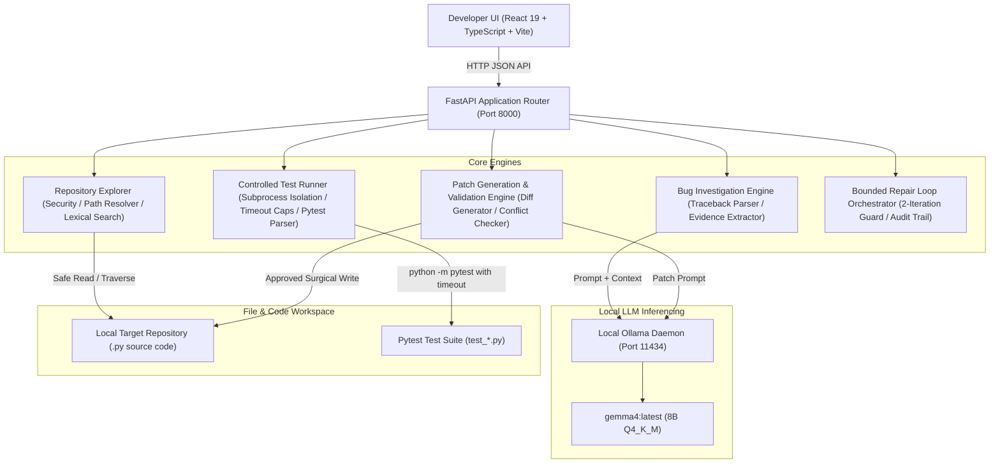

# Architecture Specification — RepoPilot

## 1. System Overview & Philosophy
RepoPilot is an autonomous, free, local-first AI software engineering agent designed to investigate bugs, synthesize minimal surgical patches, review diffs, execute regression tests inside a controlled execution sandbox, and orchestrate bounded repair loops.

RepoPilot adheres to strict engineering principles:
1. **Local-First & Zero Cloud Cost:** Powered by a local Ollama daemon using `gemma4:latest` (or any local GGUF/Ollama model). Does not require paid third-party API keys.
2. **Evidence-Before-Hypothesis:** The agent is required to extract and cite line-specific code evidence before making diagnostic claims.
3. **Explicit Human Approval:** Patches are proposed as unified diffs and never touch source files without explicit human approval.
4. **Controlled Execution Boundaries:** Arbitrary shell execution is forbidden. Only allowlisted pytest commands run inside time-capped, resource-bounded sandboxes.
5. **Bounded Repair Loops:** Self-repair attempts are strictly bounded to prevent infinite cycles. Every action is logged in an immutable audit trail.

---

## 2. High-Level Architecture Diagram

---

## 3. Subsystem Breakdown

### 3.1 Repository Explorer (`backend/app/repository.py`, `security.py`)
- **Safe Path Resolution:** `resolve_safe_path()` checks for directory traversal (`../`) and ensures all accesses remain strictly within the registered repository boundary.
- **Ignore Filters:** Automatically skips `.git`, `.venv`, `node_modules`, `__pycache__`, and binary files.
- **Lexical Search:** Line-indexed pattern matching with context line buffers for instant symbol discovery.

### 3.2 Bug Investigation Engine (`backend/app/investigator.py`, `llm.py`)
- **Provider Abstraction:** `BaseLLMProvider` decouples the agent from specific model backends (`OllamaProvider` for local inference, `MockLLMProvider` for automated testing).
- **Evidence Collector:** Scans stack traces to locate culprit files and extracts line-numbered code excerpts.
- **Structured JSON Schema:** Enforces output with `root_cause`, `evidence` array (file, start line, end line, snippet, explanation), `suggested_fix`, `recommended_test`, and `confidence`.

### 3.3 Patch Generation & Validation Engine (`backend/app/patcher.py`)
- **Unified Diff Generation:** Uses Python's `difflib.unified_diff` to compute line-level additions (`+`) and removals (`-`).
- **Conflict & Drift Detection:** Compares the live file hash/content against the pre-patch state. If modified externally, halts with conflict warnings.
- **Explicit Approval Guard:** Patches remain in `pending_review` until explicitly approved via `POST /api/patches/{id}/approve` or rejected via `POST /api/patches/{id}/reject`.

### 3.4 Controlled Test Runner (`backend/app/runner.py`)
- **Command Allowlisting:** Allows only `python -m pytest` commands. Blocks shell chaining (`;`, `&&`, `|`) and path escaping.
- **Process Isolation:** Runs subprocesses with custom `PYTHONPATH` pointing directly to the target repository.
- **Resource Caps:** Enforces strict execution timeouts (default 30s) and truncates output streams to 64KB maximum.
- **Pytest Output Parsing:** Regex-based summary extraction (`passed`, `failed`, `errors`, duration, and `=== FAILURES ===` tracebacks).

### 3.5 Bounded Repair Loop & Audit Trail (`backend/app/repair.py`)
- **Strict Bounds:** Enforces a maximum limit of 2 repair cycles. If tests do not pass after iteration 2, the session terminates with `max_iterations_reached`.
- **Failure Feedback:** Automatically extracts pytest tracebacks from iteration 1 and incorporates them into the prompt for iteration 2 (`v2`).
- **Audit Log:** Immutable array of UTC-timestamped events recording every patch generated, patch applied, test executed, and final status.
- **Exportable Verification Report:** Synthesizes structured JSON and comprehensive Markdown reports with one-click export.
